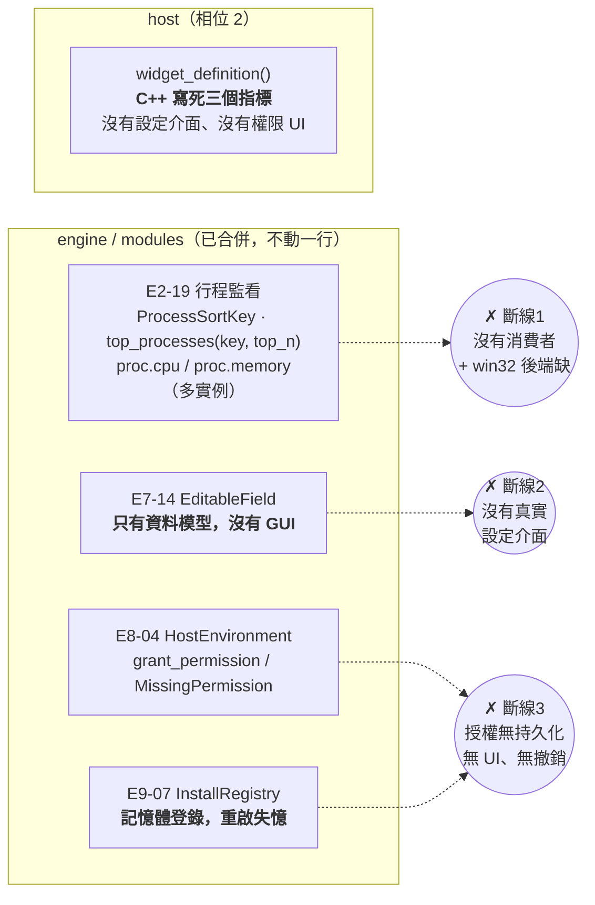
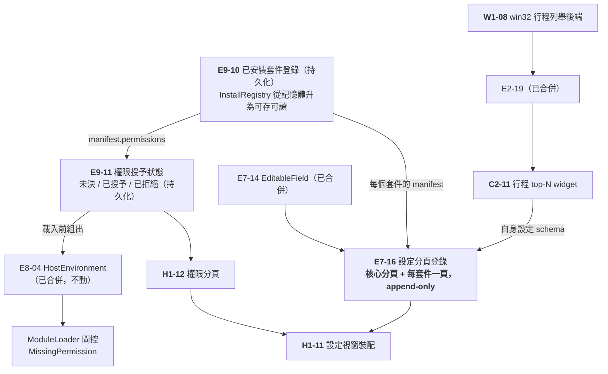
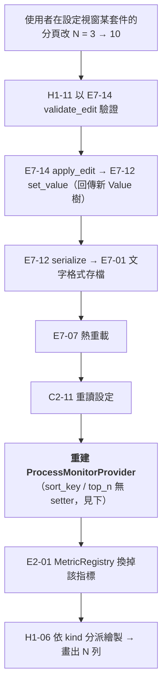

# CHG-20260829-05 — 行程 top-N widget + 設定介面 + 權限模型（需求分析與結構設計）

- Date: 2026-08-29 (UTC+0) | Branch: `claude/project-analysis-readme-njkw18` | **Risk: medium** | Implemented by: 待派
- Skill: ai-sdlc-autopilot
- Template: 標準
- Autonomy: **medium → confirm 停點**；本檔即停點材料
- Unit: 無（本 CHG 的產出是**新增工作單元到 `units.json`**，依 AGENTS.md §3）

> **狀態：等待使用者在 confirm 停點確認單元切分。未實作、未改 `units.json`。**

## Motivation

使用者提出四件事：

1. 檢視**前 N 大 service / 行程**，N 可自訂（3 / 5 / 10），依 **RAM 或 CPU** 排序
2. 需要 **permission** 的處理
3. 可以在**設定**裡進行更仔細的操作設定
4. 設定裡有哪些項目，**依「安裝了哪些 widget」而定** ——
   **有安裝即新增，即使沒打開**；而且是**額外增加設定分頁，不是覆寫既有設定**

### 查證結果：四件事裡有三件的機制已經在帳本裡

| 需求 | 既有機制（**皆已合併**） | 缺口 |
|---|---|---|
| **前 N 大行程** | **`E2-19 行程監看`**：`ProcessSortKey{Cpu, Memory}`、`top_processes(procs, key, top_n)`（`top_n==0`=全部）、`ProcessMonitorProvider` 已實作 E2-01 `MetricProvider`，掛上 `proc.cpu` / `proc.memory`，**可列舉實例 = top-N 行程**（每行程一實例，pid 為 id），五欄位 `ProcessInfo{pid,name,cpu_percent,memory_bytes,status}` | win32 後端未補（`backend_followup: true`）；host 沒接；**`sort_key`/`top_n` 只有建構子參數、沒有 setter**（見下） |
| **權限** | **`E9-02`** manifest 的 `permissions` 欄位；**`E8-04`** `HostEnvironment::grant_permission()` / `grants_permission()` + `LoadStatus::MissingPermission`（**載入期閘控已經會擋**，缺項附在 `LoadResult::missing`） | 授權決定**無持久化、無 UI、無撤銷**；沒有「使用者被問過」這件事的任何模型 |
| **設定裡更細的操作設定** | **`E7-14 圖形化設定與就地編輯`**：`build_editor_model()` → `EditableField` / `EditKind{Text,Integer,Number,Boolean,Enum,Color}` / 約束 / `validate_edit()` / `apply_edit()`（經 E7-12 寫回、回傳新 Value 樹）。檔頭明寫「**這是 GUI 設定面板背後的資料模型，而非真實 GUI**」 | **沒有真實設定介面**（host 層空白） |
| **設定項目依已安裝 widget 而定** | **`E9-07`** `InstallRegistry`（以 `manifest.name` 為鍵，`contains/add/find/size`）、`E9-06` 卸載、`E9-08` 安裝精靈 | `InstallRegistry` 檔內明寫是「**記憶體登錄**（相位 1 的安裝目標）」→ **重啟即失憶**，撐不起「有安裝即新增，即使沒打開」 |

**同形於 `CHG-20260810-08` 的結論，第三次出現**：不是要發明功能，
是**既有擴充點還沒有消費者**，而缺口集中在 host 與持久化。

### 使用者的裁定改變了結構：分頁是 append-only

使用者明確：**「由已安裝貢獻不是複寫，而是額外增加設定的 tab」**。

這不是措辭差異，是兩種完全不同的設計：

| | 併成一棵樹（**不採**） | 分頁登錄（**採用**） |
|---|---|---|
| 模型 | 把 N 份設定 schema 合併，處理同名欄位衝突 | 核心分頁固定；每個已安裝套件**追加**一個分頁 |
| 失敗模式 | 某套件的欄位覆寫核心設定 → 使用者改不回來 | 無覆寫面；最壞情況是多一個沒用的分頁 |
| 卸載 | 要把合併進去的欄位挑出來 | 移掉那個分頁 |

**append-only 是這裡唯一安全的語意**：第三方套件不該有能力改到核心設定，
而這在「合併」模型下只是一個命名巧合的距離。

## Design diagrams

### 現況：三條斷線



### 目標：設定分頁由「已安裝」驅動，append-only



### 一次「改設定」的完整路徑



## Impact

### 提議新增的 7 個工作單元

| 單元 | 層 | 風險 | 內容 | 相依 |
|---|---|---|---|---|
| **W1-08** | platform | **medium** | win32 行程列舉後端 —— `E2-19` 的 `backend_followup`（`ProcessSource` 的 win32 實作） | E2-19、W1-01 |
| **E9-10** | engine | **medium** | 已安裝套件登錄**持久化**：`InstallRegistry` 從記憶體升為可存可讀。**沿用 E7-01 文字格式 + E7-12 寫回，不發明新格式** | E9-07、E7-01、E7-12 |
| **E9-11** | engine | **medium** | 權限授予狀態：每套件每權限三態（未決 / 已授予 / 已拒絕）+ 持久化 + 查詢，並組出 `E8-04 HostEnvironment`。**不改 E8-04** | E9-02、E9-10、E8-04 |
| **E7-16** | engine | **medium** | 設定分頁登錄：核心分頁 + **每個已安裝套件追加一頁**（append-only）。消費 E7-14 的 `EditableField`，不重造欄位模型 | E7-14、E9-10 |
| **H1-11** | artifact | **medium** | 設定視窗裝配：消費 E7-16 畫出分頁與欄位，改動走 E7-14 → E7-12 → E7-07 | E7-16、H1-09 |
| **H1-12** | artifact | low | 權限分頁：列出已安裝套件與其 `permissions`，可授予 / 撤銷；消費 E9-11 | E9-11、H1-11 |
| **C2-11** | artifact | low | 行程 top-N widget：消費 `proc.cpu` / `proc.memory` 多實例指標；**N 與排序維度走 E7 宣告式設定**，因此自動出現在它自己的設定分頁 | E2-19、E4-03、E7-01 |

風險分級依 `docs/ai-guideline.md` §6：
- **W1-08**：平台耦合（行程列舉的 win32 API）。
- **E9-10 / E9-11**：**一旦存了就要相容**（E7-08 設定遷移的適用對象），格式錯了日後要遷移。
- **E9-11** 另有安全面：它是「誰能做什麼」的唯一真實來源，錯了是權限漏洞不是 bug。
- **E7-16 / H1-11**：承重點，其餘 host 單元相依它們。

### 三個必須在停點裁決的設計問題

#### Q-A：`sort_key` / `top_n` 沒有 setter，切換排序維度怎麼做？

`ProcessMonitorProvider` 的 `sort_key` 與 `top_n` **只有建構子參數**，
且**指標 id 隨排序維度改變**（`proc.cpu` ↔ `proc.memory`）。所以「在設定裡切換排序維度」
不是改一個值，是**換掉註冊在 E2-01 上的指標**。兩條路：

| 方案 | 做法 | 代價 |
|---|---|---|
| **A1（建議）** | host 在設定變更時**重建 provider** 並重新註冊 | 歷史環重置（切換維度後折線圖從頭開始）。但切換維度本來就換了單位（% ↔ MB），保留歷史反而是錯的 |
| A2 | 替 `E2-19` 加 setter | **要改一個已合併單元** → 依 AGENTS.md §4「需要超出鎖定範圍 → 停下回報」，必須另開 CHG 且不屬本案 |

**本檔採 A1**，並把「切換維度 = 換指標，歷史不保留」寫進 C2-11 的驗收。

#### Q-B：設定視窗與 `H1-09 就地編輯裝配` 的關係

`H1-09`（**尚未實作**，`CHG-20260810-08` 寫入，`write_scope: host/edit/**`）
已經要消費 E7-14 / E7-12 / E7-15 / E7-07 —— 與 H1-11 設定視窗**重疊**。
兩者是同一組 engine 能力的兩種呈現：H1-09 是「在 widget 上直接拖」，H1-11 是「設定視窗」。

**建議：H1-11 相依 H1-09**，共用其編輯裝配，設定視窗只做「分頁 + 欄位列表」的呈現。
否則同一條「驗證 → 寫回 → 熱重載」鏈會有兩份，日後必然分岔。
**但這會讓 H1-11 排在 wave 20 之後**，整案被 H1-06~H1-09 擋住。
若使用者要讓設定介面先行，就得接受兩份裝配暫時並存 —— 這是取捨，不是對錯。

#### Q-C：權限在什麼時機問使用者？

`E8-04` 的閘控在**載入時**：缺權限就 `MissingPermission` 拒載。
所以授權決定必須**早於載入**。兩種時機：

| 時機 | 體驗 | 風險 |
|---|---|---|
| **安裝時問**（建議） | 安裝精靈（E9-08）顯示該套件要求的 permissions，使用者一次決定 | 使用者在還沒用過之前就要判斷，容易全部按同意 |
| 首次使用時問 | 情境清楚 | 要讓模組載入失敗後能重試，E8-04 沒有這個流程，**會動到已合併單元** |

**本檔採「安裝時問」**，理由是它不需要改 E8-04。
三態中的「未決」用途：使用者在安裝精靈按了取消，之後能在設定的權限分頁補決定。

### 不含（避免越界）

- **不改 `E2-19` / `E7-14` / `E8-04` / `E9-02` 任何一行。** 它們都已合併且可用；
  本案是「終於有人去消費它們」。過程中若發現上游介面不足 → **停下回報，另開 CHG**。
- **不做第三方生態的治理設施**（沙箱、崩潰隔離、線上分發）——
  `docs/requirements.md`「明確不做」已排除。本案的 permission 是**宣告 + 載入期閘控 + 使用者可見**，
  **不是沙箱**：權限被授予後沒有任何東西在執行期強制它。這一點必須寫進 README／設定介面，
  **否則它會被當成安全邊界，而它不是。**
- 不做 Claude token 額度 widget —— 它卡在「祕密保存」的空白（見 `HANDOFF` §0-D），
  應另開 CHG 先裁決祕密模型。

## Status

Paused — 等待使用者在 confirm 停點裁決 Q-A / Q-B / Q-C 與 7 個單元的切分。

> 以 `Paused` 進 main 是刻意的：`CHG-20260810-03` 的 G7 會擋下 `Proposed`，
> 而 `Paused` 是它明訂的合法 WIP。一份**刻意擱置、等人決定**的設計紀錄應該進得了 main。
> 同 `CHG-20260810-08` 的做法。

## Verification

### 本 CHG 自身（純文件，未改帳本）

```
python3 scripts/stage_check.py      → OK（193 個單元無階段違規；本檔未改 units.json）
python3 scripts/run_python_tests.py → OK
python3 scripts/status_check.py     → OK
```

### 查證依據（皆讀原始碼，非從標題推論）

| 結論 | 證據 |
|---|---|
| E2-19 已有 top-N 與雙排序維度 | `modules/sysinfo/process_monitor.hpp`：`enum class ProcessSortKey{Cpu,Memory}`、`top_processes(procs, key, top_n)`、`kAllProcesses = 0` |
| `sort_key`/`top_n` 無 setter | 同檔 `ProcessMonitorProvider` 建構子為唯一設定點；`metric_id()` 依 `sort_key_` 回傳不同 id |
| E7-14 只有模型沒有 GUI | `engine/format/editor_model.hpp` 檔頭：「這是 GUI 設定面板背後的**資料模型**，而非真實 GUI」 |
| E8-04 已有載入期權限閘控 | `engine/script/module_loader.hpp`：`HostEnvironment::grant_permission/grants_permission`、`LoadStatus::MissingPermission`、`LoadResult::missing` |
| InstallRegistry 是記憶體的 | `engine/package/drop_install.hpp`：「記憶體套件登錄（相位 1 的安裝目標）」，`std::map<std::string, Package> by_name_` |
| 全庫無憑證保存單元 | 以 `憑證\|密鑰\|secret\|credential\|認證` 掃過 `units.json` 全部 193 筆，無命中 |

### 各單元的驗收（先行約定，避免事後遷就結果）

1. **append-only 的反向斷言**（E7-16）：安裝一個 manifest 宣告與核心設定同名欄位的套件，
   **核心分頁的值不得被改動**。這條是使用者裁定的具體形式，必須以測試釘住。
2. **「有安裝即新增，即使沒打開」**（E9-10 + E7-16）：安裝 → 不載入 → 重啟 →
   設定視窗仍列出該套件的分頁。**重啟這一步是重點**，記憶體登錄過不了。
3. **卸載對稱**（E9-06 + E7-16）：卸載後分頁消失，且核心分頁不受影響。
4. **權限閘控真的會擋**（E9-11）：拒絕某 permission 後，該模組載入必須回
   `MissingPermission` 且 `missing` 附上缺項 —— **不得靜默降級成「載入成功但功能沒作用」**。
5. **撤銷會生效**（E9-11 + H1-12）：已授予 → 在設定撤銷 → 重啟後載入被擋。
6. **top-N 切換**（C2-11）：N 由 3 改 10，畫面列數跟著變；
   排序維度由 CPU 改 RAM，單位由 `%` 變 `MB`、指標 id 由 `proc.cpu` 變 `proc.memory`。
7. **不得退步**：187 個 ctest 全綠。
